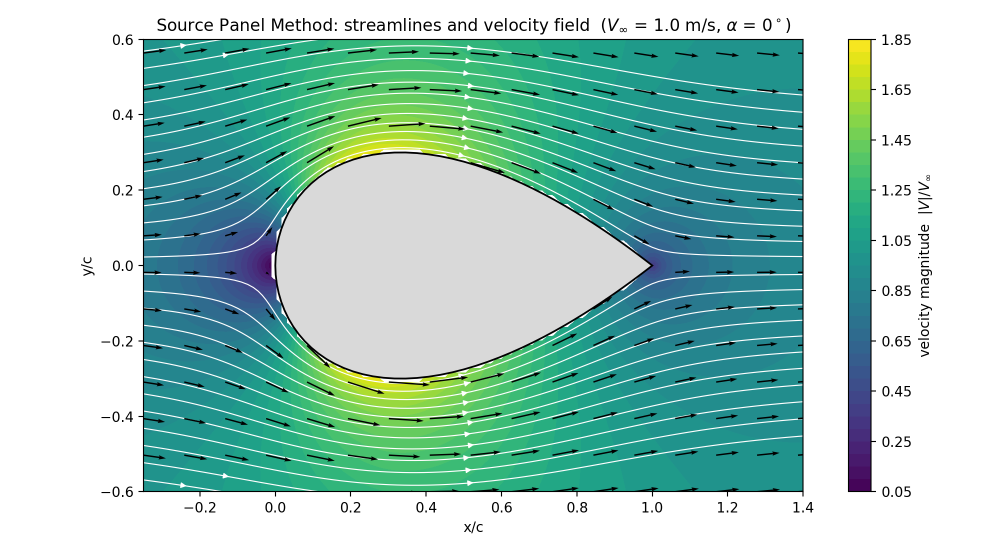
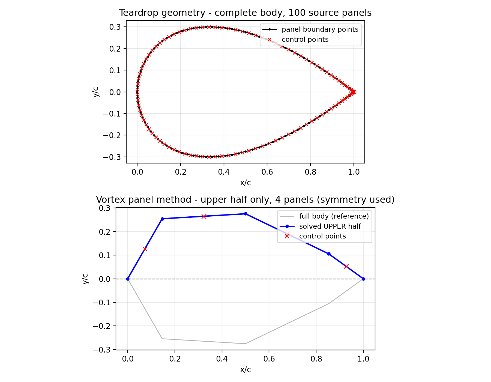
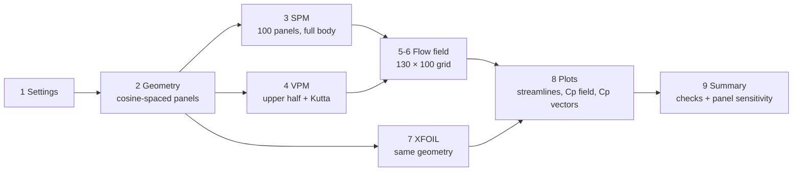
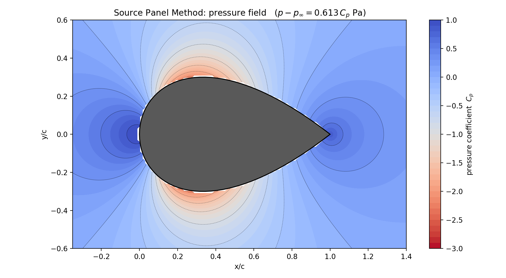
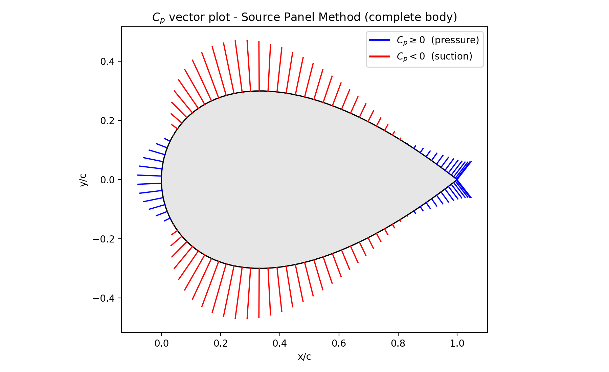
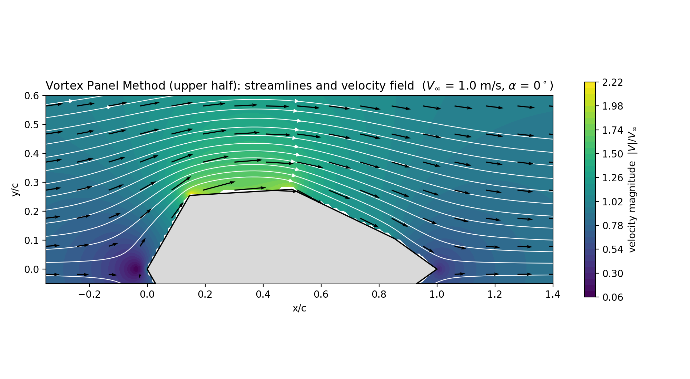
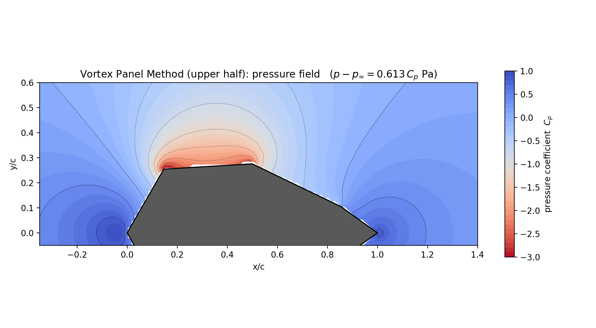
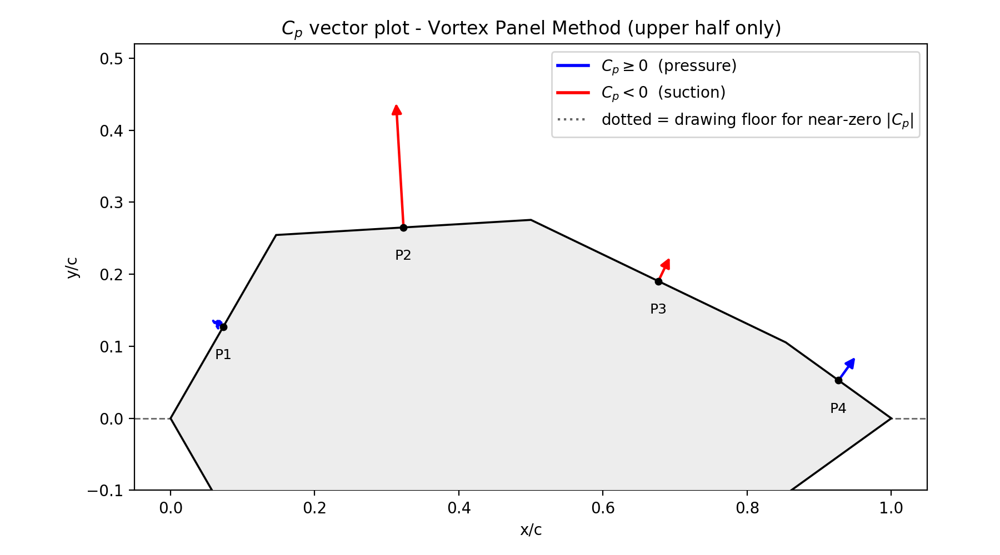
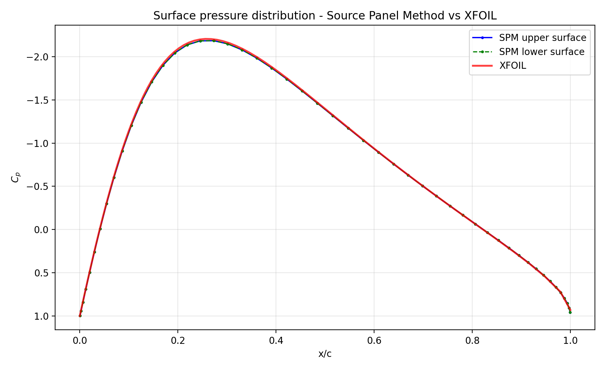
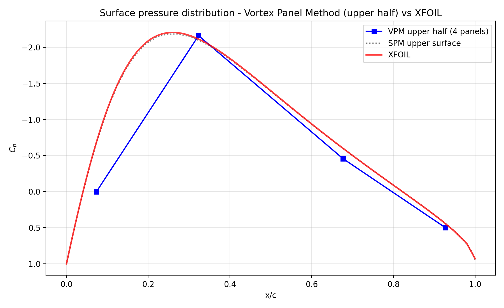

# Teardrop Aerofoil: Source and Vortex Panel Methods in Python

**An inviscid potential-flow solver for a teardrop body, written in Python and validated against XFOIL.**
Aerodynamics (ME 4811), Islamic University of Technology (IUT), August 2026. Individual project by Mehdi Hasan.



| | |
|---|---|
| **Geometry** | Teardrop, 60 % thick, rounded nose, sharp tail (y ∝ √x (1 − x)) |
| **Methods** | Constant-strength **source** panels on the complete body; constant-strength **vortex** panels on the upper half (symmetry) |
| **Flow** | V∞ = 1 m/s, α = 0°, ρ = 1.225 kg/m³, chord = 1 |
| **Validation** | Surface Cp vs **XFOIL**: RMSE 0.011 (upper) and 0.010 (lower) |
| **Language** | Python 3 · NumPy · Matplotlib |
| **Run time** | about 30 s |

---

## Contents

1. [Why panel methods?](#1-why-panel-methods)
2. [Theory](#2-theory)
3. [Geometry](#3-geometry)
4. [Implementation](#4-implementation)
5. [Results](#5-results)
6. [Validation](#6-validation)
7. [Why the vortex method is less accurate here](#7-why-the-vortex-method-is-less-accurate-here)
8. [Applications](#8-applications)
9. [How to run](#9-how-to-run)
10. [Repository contents](#10-repository-contents)
11. [References](#11-references)

---

## 1. Why panel methods?

Before CFD meshes and turbulence models, aerodynamicists needed a way to compute the pressure on arbitrary shapes. **Panel methods** (Hess & Smith, 1967) do this by covering the body surface with straight panels carrying flow singularities (sources, vortices or doublets) and choosing their strengths so that no flow passes through the surface. Only the boundary is discretised, so a solution takes milliseconds.

They remain in daily use: XFOIL, XFLR5, AVL and VSPAERO are built on them, and they are the standard first tool for aerofoil and wing design, propeller blades, and early aircraft sizing.

**Assignment:** apply the **vortex** panel method to *one half* of a teardrop and the **source** panel method to the *complete* body, plot streamlines, velocity, pressure fields and Cp vectors, and compare surface pressure with XFOIL.

---

## 2. Theory

The flow is assumed **incompressible, inviscid and irrotational**, so a velocity potential φ exists with $\nabla^2\phi = 0$. Superposition of a uniform stream and *N* panels gives the potential at any point.

### 2.1 Source panel method (SPM)

Panel *j* carries a constant source strength $\lambda_j$ per unit length. The normal velocity at the control point of panel *i* must be zero:

$$\frac{\lambda_i}{2} + \sum_{j\ne i}\frac{\lambda_j}{2\pi}\,I_{ij} + V_\infty\cos\beta_i = 0,\qquad i = 1..N$$

where $I_{ij}$ is the geometric integral of the normal velocity induced at *i* by panel *j*, and $\beta_i$ is the angle between the outward normal and the freestream. After solving the *N × N* system, the tangential velocity is

$$V_{t,i} = \sum_{j\ne i}\frac{\lambda_j}{2\pi}\,J_{ij} + V_\infty\sin\beta_i,\qquad C_{p,i} = 1 - \left(\frac{V_{t,i}}{V_\infty}\right)^2$$

A closed body must have zero net source strength, $\sum_j \lambda_j S_j = 0$, which is a built-in accuracy check.

Sources alone carry **no circulation**, so the SPM cannot produce lift. For a symmetric body at α = 0 that is exactly right.

### 2.2 Vortex panel method (VPM)

Panel *j* carries a constant vortex strength $\gamma_j$. The flow-tangency condition gives

$$\sum_{j}\frac{-\gamma_j}{2\pi}\,K_{ij} + V_\infty\cos\beta_i = 0$$

and the **Kutta condition** at a sharp trailing edge closes the system: $\gamma_{TE,upper} + \gamma_{TE,lower} = 0$. Circulation is $\Gamma = \sum \gamma_j S_j$; lift follows from Kutta–Joukowski, $L' = \rho V_\infty \Gamma$. Here the VPM is applied only to the **upper half** using symmetry about the chord line.

### 2.3 Flow field and forces

- Velocity at grid points: freestream plus the contribution of every panel (the $M_x, M_y$ and $N_x, N_y$ streamline integrals).
- Pressure field: $p - p_\infty = \tfrac12 \rho V_\infty^2 C_p$.
- Force coefficients: integrate $C_p$ over the panels; for a closed body in inviscid flow, drag must be zero (**d'Alembert's paradox**).

---

## 3. Geometry

The half-thickness is

$$y(x) = t_{max}\,\frac{\sqrt{x}\,(1-x)}{2/(3\sqrt3)},\qquad 0\le x\le 1$$

- $\sqrt{x}$ gives a **rounded nose**; $(1-x)$ gives a **sharp trailing edge**.
- $\sqrt{x}(1-x)$ peaks at $x = 1/3$ with value $2/(3\sqrt3) \approx 0.385$, so the formula normalises the maximum half-thickness to $t_{max} = 0.30$, a 60 %-thick body.
- **Cosine spacing** $x = \tfrac12(1-\cos\theta)$ clusters panels at the nose and tail where curvature is high.
- Points run clockwise TE → lower → LE → upper → TE, the ordering the panel integrals expect.



---

## 4. Implementation

`code/teardrop_panel_method.py` is organised in nine steps:



| Setting | Value |
|---|---|
| SPM panels (complete body) | 100 |
| VPM panels (upper half) | 4 (best of a sensitivity study over 4–20) |
| Flow-field grid | 130 × 100 |
| Maximum half-thickness | 0.30 c |

The geometric integrals (`COMPUTE_IJ_SPM`, `COMPUTE_KL_VPM`, `STREAMLINE_SPM`, `STREAMLINE_VPM`) are the course-supplied routines by JoshTheEngineer (MIT License; see [THIRD_PARTY_NOTICES.md](THIRD_PARTY_NOTICES.md)). Everything else, including geometry, solvers, flow field, XFOIL coupling, plotting and validation, was written for this project.

---

## 5. Results

### Source panel method (complete body)

|  |  |
|---|---|
| Streamlines coloured by speed, with velocity vectors | Pressure-coefficient field |

The flow stagnates at the nose (Cp → 1), accelerates over the thick shoulder (minimum Cp near x ≈ 0.3), and recovers towards the tail. The field ranges from **+0.61 Pa** above freestream at the stagnation points to **−1.37 Pa** over the shoulder ($p - p_\infty = \tfrac12\rho V_\infty^2 C_p$).



*Cp vectors: each line is drawn along the outward surface normal with length ∝ |Cp|; **blue** = pressure (Cp ≥ 0), **red** = suction (Cp < 0).*

### Vortex panel method (upper half)

|  |  |
|---|---|
| Upper-half streamlines and velocity | Upper-half Cp field |



---

## 6. Validation

| Check | Result | Expected |
|---|---|---|
| Stagnation pressure, $C_{p,max}$ | **0.9935** | 1.0 exactly |
| Closed-body source balance $\sum\lambda_j S_j$ | 6.6 × 10⁻³ | 0 |
| No-penetration residual | ≈ 10⁻¹⁵ (both methods) | 0 |
| Lift $C_L$ and total circulation | 0 and 0 | 0 (symmetric body, α = 0) |
| Drag $C_D$ | 0.0047 | 0 (d'Alembert's paradox) |
| SPM Cp vs XFOIL, RMSE | **0.011** upper, **0.010** lower | small |

|  |  |
|---|---|
| Source method vs XFOIL: curves almost overlap | Vortex method (upper half) vs XFOIL and SPM |

---

## 7. Why the vortex method is less accurate here

The source method matches XFOIL almost exactly; the vortex method does not, and that is expected, not a coding error.

1. **No circulation to represent.** A symmetric body at α = 0 carries no lift, so the flow is a pure thickness problem. Sources are the natural singularity for thickness; vortices are the natural singularity for lift.
2. **Sharp trailing edge.** The true vortex-sheet strength is singular at a sharp TE. A constant-strength (first-order) vortex panel cannot represent that singularity, so **adding panels does not reduce the error**.

The program therefore runs a **panel-count sensitivity study** (4, 6, 8, 10, 12, 16, 20 upper-half panels) and reports it rather than hiding the behaviour; 4 panels gave the lowest Cp error against XFOIL. Linear-strength vortex panels, or a combined source-plus-vortex formulation (Hess–Smith / SPVP), would fix it.

---

## 8. Applications

- **Aerofoil and wing design:** fast pressure distributions for many candidate shapes before running CFD.
- **Streamlined bodies:** fairings, struts, cable housings, bicycle and vehicle components with teardrop sections.
- **Propeller and turbine blades:** section pressure distributions for blade-element methods.
- **Teaching and verification:** a check on CFD set-ups (inviscid limit, stagnation Cp = 1).
- **Boundary-layer coupling:** the Cp distribution feeds viscous methods, as XFOIL does.

---

## 9. How to run

**Requirements:** Python 3.8+ with NumPy and Matplotlib (`pip install -r requirements.txt`).

**Windows:** double-click `code/RUN_PROJECT.bat`; it checks for Python and installs missing packages.

**Any OS:**

```bash
cd code
python teardrop_panel_method.py
```

Figures go to `code/outputs/`. To compare with XFOIL, download XFOIL from [web.mit.edu/drela/Public/web/xfoil](https://web.mit.edu/drela/Public/web/xfoil/) and place `xfoil.exe` in `code/`. Without it the comparison is skipped and everything else still runs. The XFOIL output used for this README is saved in `code/reference_data/xfoil_cp.txt`.

Change `N_SPM`, `N_VPM_HALF`, `THICKNESS`, `ALPHA_DEG` or `V_INF` at the top of the script to explore other cases. Detailed notes are in [docs/run-instructions.txt](docs/run-instructions.txt).

---

## 10. Repository contents

```
teardrop-panel-method/
├── README.md
├── requirements.txt
├── THIRD_PARTY_NOTICES.md          ← MIT licence for the four helper routines
├── code/
│   ├── teardrop_panel_method.py    ← main program (this project)
│   ├── COMPUTE_IJ_SPM.py           ← source-panel integrals (JoshTheEngineer, MIT)
│   ├── COMPUTE_KL_VPM.py           ← vortex-panel integrals (JoshTheEngineer, MIT)
│   ├── STREAMLINE_SPM.py           ← source flow-field integrals (JoshTheEngineer, MIT)
│   ├── STREAMLINE_VPM.py           ← vortex flow-field integrals (JoshTheEngineer, MIT)
│   ├── RUN_PROJECT.bat             ← Windows one-click launcher
│   └── reference_data/             ← teardrop .dat geometry, XFOIL Cp output
├── images/                         ← the nine output figures
└── docs/run-instructions.txt
```

## 11. References

1. J. L. Hess and A. M. O. Smith, "Calculation of potential flow about arbitrary bodies," *Progress in Aerospace Sciences*, vol. 8, pp. 1–138, 1967. doi:[10.1016/0376-0421(67)90003-6](https://doi.org/10.1016/0376-0421(67)90003-6)
2. J. Katz and A. Plotkin, *Low-Speed Aerodynamics*, 2nd ed. Cambridge University Press, 2001.
3. J. D. Anderson Jr., *Fundamentals of Aerodynamics*, 6th ed. McGraw-Hill, 2017.
4. M. Drela, "XFOIL: An analysis and design system for low Reynolds number airfoils," in *Low Reynolds Number Aerodynamics*, Lecture Notes in Engineering, vol. 54, Springer, 1989, pp. 1–12. doi:[10.1007/978-3-642-84010-4_1](https://doi.org/10.1007/978-3-642-84010-4_1)
5. JoshTheEngineer, *Panel_Methods* (Python/MATLAB source and vortex panel codes), GitHub, MIT License. [github.com/jte0419/Panel_Methods](https://github.com/jte0419/Panel_Methods)

---

<sub>© 2026 Mehdi Hasan (helper routines © 2019 Josh, MIT License) · [Portfolio](https://mehdi-hasan.netlify.app) · [LinkedIn](https://www.linkedin.com/in/mehdi-hasan-868639245)</sub>
